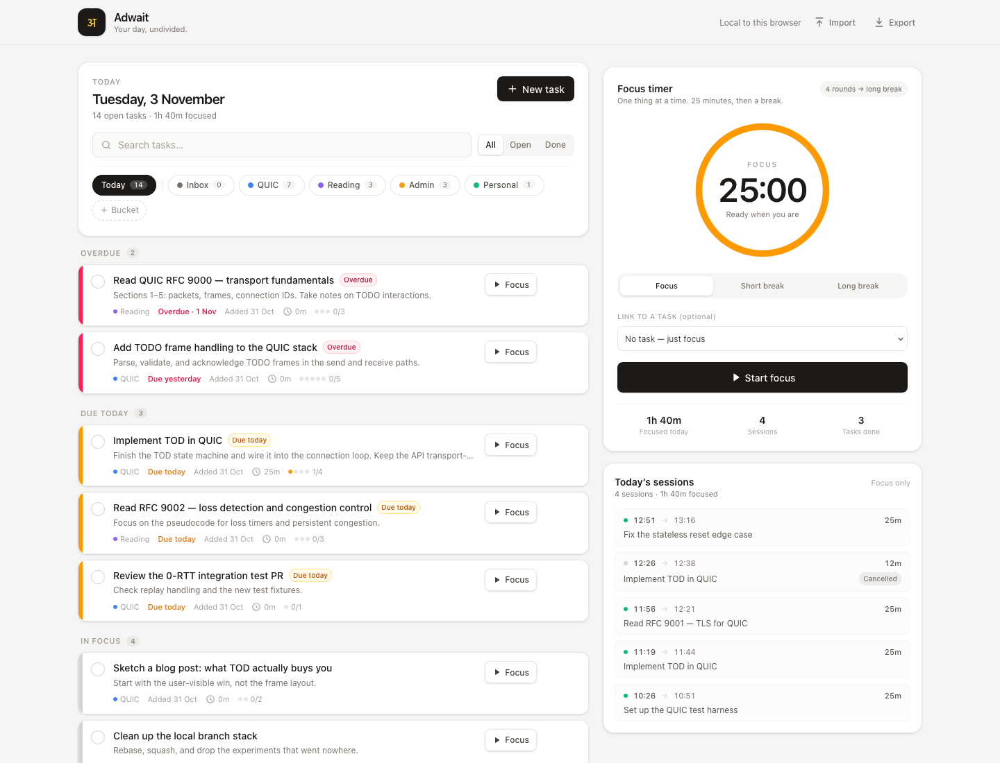
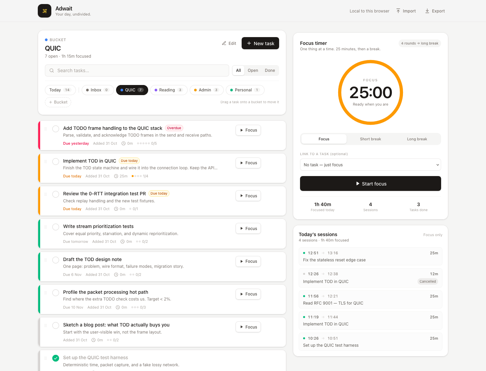

# Adwait

**Your day, undivided.**

Adwait is a single-pane productivity app: today's tasks on the left, a pomodoro timer on the right. Tasks are color-coded by whether they're on track, and every focus session is logged against the day — and optionally against a task.

The name comes from Sanskrit *advaita* (अद्वैत), “not two” — the work and the time spent on it are one.



A bucket view keeps a project's tasks and focus time together:



The screenshots use the demo data below.

## What's here

- Create, edit, complete, and delete tasks.
- Buckets for projects (Work, Personal, Finance…) with create, rename, recolor, and delete.
- Drag to reorder inside a bucket, or drop a task onto another bucket tab to move it.
- Today view with overdue, due-today, pinned, Later, and done-today groups; bucket chips show where each task lives.
- On-track colors computed from due dates: red = overdue, amber = due today, green = future, gray = no date.
- Pomodoro timer with focus / short break / long break modes.
- Start, pause, resume, and cancel; the timer is timestamp-based, so refresh, sleep, and background tabs are safe.
- Chime, in-app toast, and optional desktop notification when a session ends.
- Sessions logged with start/end time and duration; unlinked sessions can be attached to a task afterward.
- Time taken per task rolls up from completed focus sessions.
- Local-first persistence in `localStorage`, plus JSON export/import.
- Shareable bucket links: append `#bucket=<id>` to open that bucket directly.

## Run it

Requires Node.js 20+.

```bash
npm install
npm run dev
```

Open the URL Vite prints (usually `http://localhost:5173`).

```bash
npm test        # unit + app smoke tests
npm run build   # type-check and production build
npm run preview # serve the production build
```

## How the timer works

The active timer stores an `endsAt` timestamp. The UI recomputes the remaining time every 250 ms instead of decrementing a counter, which keeps it accurate when the tab is throttled or the machine sleeps. The active timer is persisted, so a refresh resumes it; if it finished while the tab was closed, the session is finalized exactly once on the next load.

Cancel logs the time actually focused as a cancelled session (it is excluded from a task's main time-taken number). Breaks are recorded but hidden from the focus-only session log for now.

## Data & backup

Everything lives in this browser under the `adwait:v1` localStorage key. No account or server.

- **Export** downloads `adwait-backup-YYYY-MM-DD.json`.
- **Import** replaces the current data after confirmation.

Corrupt saved data is quarantined under `adwait:corrupt:<timestamp>` rather than crashing the app.

## Demo data

[`demo/adwait-demo.json`](./demo/adwait-demo.json) is an importable backup with
QUIC-flavoured tasks, five buckets, completed tasks, and focus sessions. Export
your current data first, then use **Import** — importing replaces everything.
Dates are relative, so run `npm run demo` after a while to refresh them before
taking screenshots. See [`demo/README.md`](./demo/README.md).

## Stack

Vite · React 19 · TypeScript · Tailwind CSS v4 · Zustand · date-fns · Web Audio API · Vitest

## Roadmap

- **Phase 2 (done):** buckets with drag-to-reorder and drag-between-buckets, bucket view with focus totals, bucket deep links.
- **Phase 3:** estimate-aware at-risk colors, undo, stats/streaks, daily goal, PWA/offline, keyboard shortcuts, settings, accessibility pass.
- **Phase 4:** optional accounts and sync.

See [PLAN.md](./PLAN.md) for the full spec, data model, and acceptance criteria.
